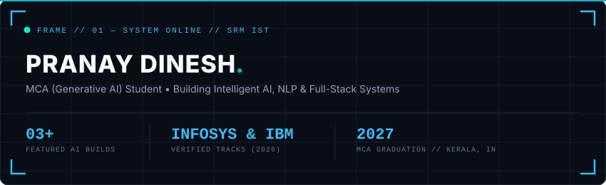

<!-- Custom HUD Hero Card (Hosted in Repo) -->

  

<!-- Live Typing Terminal Sub-header -->

  

<!-- Direct Uplink Badges -->

  
  
  

---

<!-- Custom HUD Engineering Philosophy & Animated Proficiency Bars -->

  

---

### `// TECHNICAL ARSENAL`

  

---

### `// SELECTED WORKS`

<table>
  <tr>
    <td width="33%" valign="top">
      <h4><code>01</code> // SignBridge AI</h4>
      
<b><code>AI / COMPUTER VISION</code></b>

      
Indian Sign Language (ISL) gesture processing & media retrieval pipeline powered by Python and Hugging Face datasets.

    </td>
    <td width="33%" valign="top">
      <h4><code>02</code> // Finora (Spendwise)</h4>
      
<b><code>FASTAPI / SQLITE</code></b>

      
Personal finance web app featuring secure authentication, salary tracking, SQLite storage, and multi-year savings projections.

    </td>
    <td width="33%" valign="top">
      <h4><code>03</code> // Auto Gallery</h4>
      
<b><code>HTML / CSS / PHP / MYSQL</code></b>

      
Online vehicle shopping system allowing users to purchase vehicles, spare parts, and book vehicle services easily from home.

    </td>
  </tr>
</table>

---

### `// VERIFIED CERTIFICATIONS (IBM)`

- 🏅 **Generative AI: Introduction and Applications** — *IBM*
- 🏅 **Generative AI: Prompt Engineering Basics** — *IBM*
- 🏅 **Generative AI: Foundation Models and Platforms** — *IBM*
- 🏅 **Generative AI: Impact, Considerations, and Ethical Issues** — *IBM*
- 🏅 **Generative AI: Business Transformation and Career Growth** — *IBM*

---

<!-- Glowing Snake Motion Divider -->

  

<!-- Custom Animated Neural Network Footer Card -->

  

